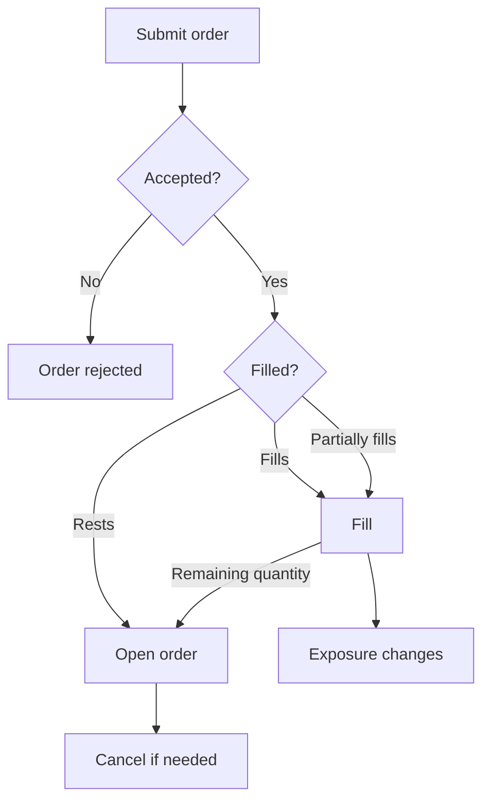

> ## Documentation Index
> Fetch the complete documentation index at: https://docs.polymarket.com/llms.txt
> Use this file to discover all available pages before exploring further.

# Trading

> Place, manage, and reconcile Perps orders

> [!NOTE]
>
> Trading workflows require an [authenticated
> session](/perps/authenticated-sessions.md).

Perps trading changes account exposure on an instrument. An order expresses what
the account wants to do, but exposure only changes when the order fills.

An accepted order can rest on the book before it fills.



Use order state to track accepted, resting, modified, canceled, or rejected
orders. Use fills and portfolio state to confirm any exposure change.

## Start an Authenticated Session

Open an authenticated session before reading private account state or submitting
trading commands. See [Authenticated Sessions](/perps/authenticated-sessions.md) for
the full setup flow.

**TypeScript**

Create a `SecureClient`.

```ts theme={null}
import { createSecureClient } from "@polymarket/client";
import { privateKey } from "@polymarket/client/viem";

const client = await createSecureClient({
  wallet: process.env.POLYMARKET_WALLET_ADDRESS!,
  signer: privateKey(process.env.PRIVATE_KEY!),
});
```

Open the Perps session.

```ts theme={null}
const session = await client.openPerpsSession();
```

**Python**

Create an `AsyncSecureClient`.

```python theme={null}
import os

from polymarket import AsyncSecureClient

client = await AsyncSecureClient.create(
    private_key=os.environ["PRIVATE_KEY"],
    wallet=os.environ["POLYMARKET_WALLET_ADDRESS"],
)
```

Open the Perps session.

```python theme={null}
session = await client.open_perps_session()
```

**API**

Use proxy credentials for private reads and signed trading commands.

```http theme={null}
polymarket-proxy: <proxy_address>
polymarket-secret: <proxy_secret>
```

## Prepare a Trade

Start by identifying the Perps instrument you want to trade. Instruments define
the market and include the constraints used later when building an order.

**TypeScript**

Fetch instruments and select the market you want to trade.

```ts theme={null}
const instruments = await client.fetchPerpsInstruments();
const instrument = instruments.find((item) => item.symbol === "BTC-PERP");

if (!instrument) {
  throw new Error("Instrument not found");
}
```

Keep the selected `instrument` available for the next steps.

**Python**

Fetch instruments and select the market you want to trade.

```python theme={null}
instruments = await client.fetch_perps_instruments()
instrument = next((item for item in instruments if item.symbol == "BTC-PERP"), None)

if instrument is None:
    raise RuntimeError("Instrument not found")
```

Keep the selected `instrument` available for the next steps.

**API**

Fetch instruments and select the market you want to trade.

```bash theme={null}
curl "https://api.perpetuals.polymarket.com/v1/info/instruments"
```

The response is a list of instruments.

```json theme={null}
[
  {
    "instrument_id": 1,
    "instrument_type": "perpetual",
    "category": "crypto",
    "symbol": "BTC-PERP",
    "base_asset": "BTC",
    "quote_asset": "USD",
    "funding_interval": "1h",
    "quantity_decimals": 4,
    "price_decimals": 2,
    "price_bounds": "0.1",
    "liquidation_fee": "0.01",
    "max_order_count": 200,
    "min_notional": "1",
    "max_market_notional": "100000",
    "max_limit_notional": "1000000",
    "max_leverage": 10,
    "isolated_only": false,
    "risk_tiers": [{ "lower_bound": "0", "max_leverage": 10 }],
    "ui_live_time": null
  }
]
```

Keep the selected instrument for the next steps.

## Choose Direction and Size

Before placing an order, decide whether it should open new exposure, increase
existing exposure, reduce exposure, or close the position.

The effect of a buy or sell depends on the current position.

| Current position | Buy order | Sell order |
| - | - | - |
| No position | Opens long | Opens short |
| Long | Increases long | Reduces or closes long |
| Short | Reduces or closes short | Increases short |

To close a position, submit an order in the opposite direction for the current
open position size.

**TypeScript**

Read the portfolio when the order decision depends on current exposure.

```ts theme={null}
const portfolio = await session.fetchPortfolio();
const position = portfolio.positions.find(
  (item) => item.instrumentId === instrument.id,
);
```

Positive `position.size` means the account is long. Negative `position.size`
means the account is short. No matching position means the account has no open
exposure for that instrument.

**Python**

Read the portfolio when the order decision depends on current exposure.

```python theme={null}
portfolio = await session.fetch_portfolio()
position = next(
    (item for item in portfolio.positions if item.instrument_id == instrument.id),
    None,
)
```

Positive `position.size` means the account is long. Negative `position.size`
means the account is short. No matching position means the account has no open
exposure for that instrument.

**API**

Read the portfolio when the order decision depends on current exposure.

```bash theme={null}
curl "https://api.perpetuals.polymarket.com/v1/account/portfolio" \
  -H "polymarket-proxy: <proxy_address>" \
  -H "polymarket-secret: <proxy_secret>"
```

The response includes current positions.

```json theme={null}
{
  "positions": [
    {
      "instrument_id": 1,
      "symbol": "BTC-PERP",
      "size": "0.01",
      "entry_price": "65000",
      "leverage": 5,
      "cross": false,
      "initial_margin": "130",
      "maintenance_margin": "65",
      "position_value": "650",
      "liquidation_price": "52000",
      "unrealized_pnl": "0",
      "return_on_equity": "0",
      "cumulative_funding": "0"
    }
  ],
  "margin": {
    "total_account_value": "1000",
    "available_order_margin": "870",
    "total_initial_margin": "130",
    "total_maintenance_margin": "65",
    "total_position_value": "650"
  },
  "withdrawable": "870",
  "in_liquidation": false,
  "fee_tier": 0,
  "timestamp": 1767000000000
}
```

Positive `positions[].size` means the account is long. Negative
`positions[].size` means the account is short. No matching position means the
account has no open exposure for that instrument.

## Place Orders

Place an order when the account is ready to express buy or sell intent. Use an
explicit limit price when you need price protection. Use immediate-or-cancel
execution when the order should fill immediately or cancel any unfilled quantity.

**TypeScript**

**1. Choose a Price**

Fetch a ticker when you need a lightweight current-price reference. Fetch the
book when the order price depends on spread, depth, or top-of-book liquidity.

```ts theme={null}
const ticker = await client.fetchPerpsTicker({ instrumentId: instrument.id });
const book = await client.fetchPerpsBook({ instrumentId: instrument.id });
```

Set `price` as pUSD per quantity unit, rounded to `instrument.priceDecimals`.

**2. Build the Order**

Create the order request from the direction, price, quantity, and execution
behavior you chose. This example submits an immediate-or-cancel (IOC) buy order
for `0.01` BTC-PERP at `65000` pUSD per quantity unit.

```ts theme={null}
import {
  OrderSide,
  PerpsTimeInForce,
  type PlacePerpsOrderRequest,
} from "@polymarket/client";

const request: PlacePerpsOrderRequest = {
  instrumentId: instrument.id,
  side: OrderSide.BUY,
  price: "65000",
  quantity: "0.01",
  timeInForce: PerpsTimeInForce.IOC,
};
```

* `side` sets direction based on how you intend to open, increase, reduce, or
  close the position.
* `price` is the price you chose in the first step, in pUSD per quantity unit.
* `quantity` is the number of quantity units. Use no more than
  `instrument.quantityDecimals` decimal places.

Use `clientOrderId` when your integration needs its own identifier for tracking
or canceling the order.

```ts theme={null}
const request: PlacePerpsOrderRequest = {
  instrumentId: instrument.id,
  side: OrderSide.BUY,
  price: "65000",
  quantity: "0.01",
  timeInForce: PerpsTimeInForce.IOC,
  clientOrderId: "7f9e4a2b6c8d0e1f1234567890abcdef",
};
```

**3. Submit the Order**

Submit the request with `placeOrder`. It resolves with the matching private order
update after the order is accepted.

```ts theme={null}
const order = await session.placeOrder(request);
```

Use the returned order to track whether the order filled, expired, canceled, or
remains on the book.

```ts PerpsOrder Type theme={null}
type PerpsOrder = {
  id: PerpsOrderId;
  instrumentId: PerpsInstrumentId;
  side: OrderSide;
  price: string;
  quantity: string;
  timeInForce: PerpsTimeInForce;
  postOnly: boolean;
  status: PerpsOrderStatus;
  restingQuantity: string;
  filledQuantity: string;
  createdTimestamp: number;
  updatedTimestamp: number;
  clientOrderId?: string;
  tpSl?: PerpsTpSlOrderFields;
};
```

```json PerpsOrder Example theme={null}
{
  "id": 1234567890,
  "instrumentId": 1,
  "side": "BUY",
  "price": "65000",
  "quantity": "0.01",
  "timeInForce": "ioc",
  "postOnly": false,
  "status": "filled",
  "restingQuantity": "0",
  "filledQuantity": "0.01",
  "createdTimestamp": 1767000010000,
  "updatedTimestamp": 1767000010500,
  "clientOrderId": "7f9e4a2b6c8d0e1f1234567890abcdef"
}
```

For an IOC order, `status` can be one of these values.

| Status | Description |
| - | - |
| `PerpsOrderStatus.Filled` | The order fully filled. |
| `PerpsOrderStatus.IocNoFill` | The order did not fill. |
| `PerpsOrderStatus.IocExpired` | The order filled partially and the remainder canceled. |
| `PerpsOrderStatus.StpCancelled` | The order would have matched your own resting order, so it canceled. |

**Python**

**1. Choose a Price**

Fetch a ticker when you need a lightweight current-price reference. Fetch the
book when the order price depends on spread, depth, or top-of-book liquidity.

```python theme={null}
ticker = await client.fetch_perps_ticker(instrument_id=instrument.id)
book = await client.fetch_perps_book(instrument_id=instrument.id)
```

Set `price` as pUSD per quantity unit, rounded to `instrument.price_decimals`.

**2. Build the Order**

Create the order request from the direction, price, quantity, and execution
behavior you chose. This example submits an immediate-or-cancel (IOC) buy order
for `0.01` BTC-PERP at `65000` pUSD per quantity unit.

```python theme={null}
request = {
    "instrument_id": instrument.id,
    "side": "BUY",
    "price": "65000",
    "quantity": "0.01",
    "time_in_force": "ioc",
}
```

* `side` sets direction based on how you intend to open, increase, reduce, or
  close the position.
* `price` is the price you chose in the first step, in pUSD per quantity unit.
* `quantity` is the number of quantity units. Use no more than
  `instrument.quantity_decimals` decimal places.

Use `client_order_id` when your integration needs its own identifier for tracking
or canceling the order.

```python theme={null}
request = {
    "instrument_id": instrument.id,
    "side": "BUY",
    "price": "65000",
    "quantity": "0.01",
    "time_in_force": "ioc",
    "client_order_id": "7f9e4a2b6c8d0e1f1234567890abcdef",
}
```

**3. Submit the Order**

Submit the request with `place_order`. It resolves with the matching private
order update after the order is accepted.

```python theme={null}
result = await session.place_order(**request)
# result.order: PerpsOrder
```

Use `result.order` to track whether the order filled, expired, canceled, or
remains on the book.

```json Example theme={null}
{
  "id": 1234567890,
  "instrument_id": 1,
  "side": "BUY",
  "price": "65000",
  "quantity": "0.01",
  "time_in_force": "ioc",
  "post_only": false,
  "status": "filled",
  "resting_quantity": "0",
  "filled_quantity": "0.01",
  "created_at": 1767000010000,
  "updated_at": 1767000010500,
  "client_order_id": "7f9e4a2b6c8d0e1f1234567890abcdef"
}
```

For an IOC order, `result.order.status` can be one of these values.

| Status | Description |
| - | - |
| `filled` | The order fully filled. |
| `ioc_no_fill` | The order did not fill. |
| `ioc_expired` | The order filled partially and the remainder canceled. |
| `stp_cancelled` | The order would have matched your own resting order, so it canceled. |

**API**

**1. Choose a Price**

Fetch current market data when the order price depends on live prices or
available liquidity.

```bash theme={null}
curl -G "https://api.perpetuals.polymarket.com/v1/info/tickers" \
  --data-urlencode "instrument_id=1"

curl -G "https://api.perpetuals.polymarket.com/v1/info/book" \
  --data-urlencode "instrument_id=1" \
  --data-urlencode "depth=100"
```

Use tickers for a lightweight current-price reference. Use the book when the
order price depends on spread, depth, or top-of-book liquidity.

Set price as pUSD per quantity unit, rounded to the instrument's
`price_decimals`.

**2. Build the Order Operation**

Create a `createOrders` operation from the direction, price, quantity, and
execution behavior you chose. This example submits an immediate-or-cancel (`ioc`)
buy order for `0.01` BTC-PERP at `65000` pUSD per quantity unit.

| Concept | Field | Notes |
| - | - | - |
| Instrument | `iid` | Instrument identifier. |
| Direction | `buy` | `true` buys, `false` sells. |
| Price | `p` | Price chosen in the first step. |
| Quantity | `qty` | Number of quantity units, with no more than `quantity_decimals` decimal places. |
| Time in force | `tif` | Use `ioc` for this basic order. |
| Client order ID | `c` | Optional identifier your integration can use to track or cancel the order. Must be a 32-character lowercase hex value. |

```json theme={null}
{
  "type": "createOrders",
  "args": [
    {
      "iid": 1,
      "buy": true,
      "p": "65000",
      "qty": "0.01",
      "tif": "ioc",
      "c": "7f9e4a2b6c8d0e1f1234567890abcdef"
    }
  ]
}
```

**3. Create the Operation Hash**

Create the operation hash from the compact signable representation of the order
operation. For `createOrders`, the compact operation is:

```ts theme={null}
["createOrders", [[iid, buy, p, qty, tif, po, ro, c, tr]]];
```

Omit `undefined` array entries from the compact operation, then
MessagePack-encode it and hash the encoded bytes with `keccak256`.

The example below uses `@msgpack/msgpack` and Viem.

```ts theme={null}
import { encode } from "@msgpack/msgpack";
import { keccak256 } from "viem";

const signableOperation = [
  "createOrders",
  [
    [
      1,
      true,
      "65000",
      "0.01",
      "ioc",
      false,
      undefined,
      "7f9e4a2b6c8d0e1f1234567890abcdef",
      undefined,
    ].filter((value) => value !== undefined),
  ],
] as const;

const opHash = keccak256(encode(signableOperation));
```

**4. Create Order Typed Data**

Create an EIP-712 `Op` typed-data payload.

```json theme={null}
{
  "domain": {
    "name": "Polymarket",
    "version": "1",
    "chainId": 137
  },
  "primaryType": "Op",
  "types": {
    "Op": [
      { "name": "data", "type": "bytes32" },
      { "name": "salt", "type": "uint64" },
      { "name": "ts", "type": "uint64" }
    ]
  },
  "message": {
    "data": "<op_hash>",
    "salt": 234567890,
    "ts": 1767000010000
  }
}
```

| Field | Value |
| - | - |
| `data` | Operation hash from the previous step. |
| `salt` | Random integer generated for this signed request. |
| `ts` | Current Unix timestamp in milliseconds. |

**5. Sign Order Typed Data**

Sign the `Op` typed data with the proxy signer private key. The example below
uses Viem.

```ts Viem theme={null}
import { privateKeyToAccount } from "viem/accounts";

const account = privateKeyToAccount("<proxy_private_key>");

const signature = await account.signTypedData({
  domain: {
    name: "Polymarket",
    version: "1",
    chainId: 137,
  },
  primaryType: "Op",
  types: {
    Op: [
      { name: "data", type: "bytes32" },
      { name: "salt", type: "uint64" },
      { name: "ts", type: "uint64" },
    ],
  },
  message: {
    data: opHash,
    salt: 234567890,
    ts: 1767000010000,
  },
});
```

**6. Submit the Order**

Submit the signed request to `POST /v1/trade/orders`.

```bash theme={null}
curl -X POST "https://api.perpetuals.polymarket.com/v1/trade/orders" \
  -H "content-type: application/json" \
  -d '{
    "op": {
      "type": "createOrders",
      "args": [
        {
          "iid": 1,
          "buy": true,
          "p": "65000",
          "qty": "0.01",
          "tif": "ioc",
          "c": "7f9e4a2b6c8d0e1f1234567890abcdef"
        }
      ]
    },
    "sig": "<signature>",
    "salt": 234567890,
    "ts": 1767000010000
  }'
```

The response confirms whether the order request was accepted. Read the order
state separately to see whether it filled, expired, or rests on the book.

```json Success theme={null}
[
  {
    "status": "ok",
    "oid": 1234567890,
    "coid": "7f9e4a2b6c8d0e1f1234567890abcdef"
  }
]
```

```json Failure theme={null}
[
  {
    "status": "err",
    "error": "insufficient_margin"
  }
]
```

On success, keep `oid` as the order ID. If you supplied `c`, the response also
echoes it as `coid`.

**7. Read the Order State**

Fetch the order snapshot by `order_id` or `client_order_id` to see whether the
order filled, expired, or canceled after acceptance.

```bash Order ID theme={null}
curl -G "https://api.perpetuals.polymarket.com/v1/account/orders" \
  -H "polymarket-proxy: <proxy_address>" \
  -H "polymarket-secret: <proxy_secret>" \
  --data-urlencode "order_id=1234567890"
```

```bash Client Order ID theme={null}
curl -G "https://api.perpetuals.polymarket.com/v1/account/orders" \
  -H "polymarket-proxy: <proxy_address>" \
  -H "polymarket-secret: <proxy_secret>" \
  --data-urlencode "client_order_id=7f9e4a2b6c8d0e1f1234567890abcdef"
```

Use the order state fields to reconcile fill quantity, resting quantity, and
status.

| Field | Meaning |
| - | - |
| `order_id` | Order ID returned as `oid` in the acknowledgement. |
| `instrument_id` | Instrument identifier. |
| `buy` | `true` for buy orders, `false` for sell orders. |
| `price` | pUSD price per quantity unit. |
| `quantity` | Original order quantity. |
| `tif` | Time in force. |
| `post_only` | Whether the order was post-only. |
| `ro` | Whether the order was reduce-only. |
| `status` | Latest known order status. |
| `resting_quantity` | Quantity still resting on the book. |
| `filled_quantity` | Quantity that has filled. |
| `created_timestamp` | Creation timestamp in milliseconds. |
| `updated_timestamp` | Last update timestamp in milliseconds. |
| `client_order_id` | Client order ID, present when supplied in the request. |

If the order snapshot is not available immediately, retry the read or listen to
the private `orders` WebSocket channel for live updates.

```json theme={null}
[
  {
    "order_id": 1234567890,
    "instrument_id": 1,
    "buy": true,
    "price": "65000",
    "quantity": "0.01",
    "tif": "ioc",
    "post_only": false,
    "ro": false,
    "status": "filled",
    "resting_quantity": "0",
    "filled_quantity": "0.01",
    "created_timestamp": 1767000010000,
    "updated_timestamp": 1767000010500,
    "client_order_id": "7f9e4a2b6c8d0e1f1234567890abcdef"
  }
]
```

After this `ioc` order resolves, `status` is one of these values.

| Status | Description |
| - | - |
| `filled` | The order fully filled. |
| `ioc_no_fill` | The order did not fill. |
| `ioc_expired` | The order filled partially and the remainder canceled. |
| `stp_cancelled` | The order would have matched your own resting order, so it canceled. |

## Take Profit & Stop Loss

Use take-profit and stop-loss (TP/SL) orders to place conditional exits for a
position. A take-profit order exits when price moves in your favor. A stop-loss
order exits when price moves against you.

### How Triggers Work

TP/SL orders watch the mark price, not the last traded price. A trigger fires
when the mark price touches the trigger price, then submits a reduce-only order to
close exposure.

| Position | Take-profit fires when | Stop-loss fires when |
| - | - | - |
| Long | Mark rises to trigger | Mark falls to trigger |
| Short | Mark falls to trigger | Mark rises to trigger |

For a long position, take-profit triggers usually sit above the current mark and
stop-loss triggers usually sit below it. For a short position, the directions are
reversed.

### Market and Limit Closes

Choose how the exit should execute after the trigger fires.

| Close Type | What Happens | Available For |
| - | - | - |
| Market | The exit executes immediately against available liquidity. | Bracket orders and positions |
| Limit | The exit places a limit order and can remain open until it fills. | Bracket orders only |

A resting limit exit does not lock up the position. A more aggressive
reduce-only order on the same side (a manual close, or the position's other
trigger firing later) takes priority and cancels the resting exit to make
room. In particular, a fired stop-loss can displace a resting take-profit
exit, so a bracket whose take-profit is already resting keeps a working stop.
Closes that execute immediately never cancel a resting exit up front. See
[Close a Position](#close-a-position) for the full priority rules.

### Place a Bracket Order

A bracket order submits one entry order with up to one take-profit and one
stop-loss trigger. The triggers stay dormant until the entry fills in full. If
the entry is canceled, rejected, or only partially filled, the triggers are
canceled too. A bracket protects the completed entry, not a partial fill.

> [!NOTE]
>
> You cannot attach TP/SL triggers to an order that is already resting on the
> book. To protect a position from an existing order, wait for the fill and then
> protect the position.

**TypeScript**

Place a GTC entry order with take-profit and stop-loss triggers.

```ts theme={null}
import { OrderSide, PerpsTimeInForce } from "@polymarket/client";

const result = await session.placeOrder({
  instrumentId: instrument.id,
  side: OrderSide.BUY,
  price: "65000",
  quantity: "0.01",
  timeInForce: PerpsTimeInForce.GTC,
  takeProfit: {
    triggerPrice: "70000",
  },
  stopLoss: {
    triggerPrice: "62000",
  },
});

const entryOrderId = result.order.id;
const takeProfitOrderId = result.tpSl.takeProfit?.orderId;
const stopLossOrderId = result.tpSl.stopLoss?.orderId;
```

`result.order` is the entry order. `result.tpSl` contains the order IDs for the
conditional exits that were accepted with the entry order.

> **Output: PlacePerpsOrderWithTpSlResult**
>
> ```json theme={null}
> {
>   "order": {
>     "id": 1234567890,
>     "instrumentId": 1,
>     "side": "BUY",
>     "price": "65000",
>     "quantity": "0.01",
>     "timeInForce": "gtc",
>     "postOnly": false,
>     "status": "open",
>     "restingQuantity": "0.01",
>     "filledQuantity": "0",
>     "createdTimestamp": 1767000010000,
>     "updatedTimestamp": 1767000010500
>   },
>   "tpSl": {
>     "takeProfit": { "orderId": 1234567891 },
>     "stopLoss": { "orderId": 1234567892 }
>   }
> }
> ```

Add `limitPrice` to a trigger when the exit should place a limit order at trigger
time.

```ts theme={null}
const result = await session.placeOrder({
  instrumentId: instrument.id,
  side: OrderSide.BUY,
  price: "65000",
  quantity: "0.01",
  timeInForce: PerpsTimeInForce.GTC,
  stopLoss: {
    triggerPrice: "62000",
    limitPrice: "61900",
  },
});
```

**Python**

Place a GTC entry order with take-profit and stop-loss triggers.

```python theme={null}
from polymarket import PerpsTpSlTrigger

result = await session.place_order(
    instrument_id=instrument.id,
    side="BUY",
    price="65000",
    quantity="0.01",
    time_in_force="gtc",
    take_profit=PerpsTpSlTrigger(trigger_price="70000"),
    stop_loss=PerpsTpSlTrigger(trigger_price="62000"),
)

# result.order.id: PerpsOrderId
# result.tp_sl.take_profit.order_id: PerpsOrderId
# result.tp_sl.stop_loss.order_id: PerpsOrderId
```

`result.order` is the entry order. `result.tp_sl` contains the order IDs for the
conditional exits that were accepted with the entry order.

> **Output: PerpsOrderPlacement**
>
> ```json theme={null}
> {
>   "order": {
>     "id": 1234567890,
>     "instrument_id": 1,
>     "side": "BUY",
>     "price": "65000",
>     "quantity": "0.01",
>     "time_in_force": "gtc",
>     "post_only": false,
>     "status": "open",
>     "resting_quantity": "0.01",
>     "filled_quantity": "0",
>     "created_at": 1767000010000,
>     "updated_at": 1767000010500
>   },
>   "tp_sl": {
>     "take_profit": { "order_id": 1234567891 },
>     "stop_loss": { "order_id": 1234567892 }
>   }
> }
> ```

Add `limit_price` to a trigger when the exit should place a limit order at
trigger time.

```python theme={null}
result = await session.place_order(
    instrument_id=instrument.id,
    side="BUY",
    price="65000",
    quantity="0.01",
    time_in_force="gtc",
    stop_loss=PerpsTpSlTrigger(
        trigger_price="62000",
        limit_price="61900",
    ),
)
```

**API**

Submit the entry order and its TP/SL children in one `createOrders` operation
with `grp` set to `"order"`.

```json theme={null}
{
  "type": "createOrders",
  "grp": "order",
  "args": [
    {
      "iid": 1,
      "buy": true,
      "p": "65000",
      "qty": "0.01",
      "tif": "gtc",
      "c": "7f9e4a2b6c8d0e1f1234567890abcdef"
    },
    {
      "iid": 1,
      "buy": false,
      "qty": "0.01",
      "ro": true,
      "tr": {
        "market": true,
        "trp": "70000",
        "tpsl": "tp"
      }
    },
    {
      "iid": 1,
      "buy": false,
      "qty": "0.01",
      "ro": true,
      "tr": {
        "market": true,
        "trp": "62000",
        "tpsl": "sl"
      }
    }
  ]
}
```

Use the same signing flow as [Place Orders](#place-orders). For hashing, sign the
compact operation, not the structured JSON body. The TP/SL group is the third
compact element:

```ts theme={null}
["createOrders", [entryOrder, takeProfitOrder, stopLossOrder], "order"];
```

Then submit the signed request to `POST /v1/trade/orders`.

```bash theme={null}
curl -X POST "https://api.perpetuals.polymarket.com/v1/trade/orders" \
  -H "content-type: application/json" \
  -d '{
    "op": {
      "type": "createOrders",
      "grp": "order",
      "args": [
        {
          "iid": 1,
          "buy": true,
          "p": "65000",
          "qty": "0.01",
          "tif": "gtc",
          "c": "7f9e4a2b6c8d0e1f1234567890abcdef"
        },
        {
          "iid": 1,
          "buy": false,
          "qty": "0.01",
          "ro": true,
          "tr": {
            "market": true,
            "trp": "70000",
            "tpsl": "tp"
          }
        },
        {
          "iid": 1,
          "buy": false,
          "qty": "0.01",
          "ro": true,
          "tr": {
            "market": true,
            "trp": "62000",
            "tpsl": "sl"
          }
        }
      ]
    },
    "sig": "<signature>",
    "salt": 234567890,
    "ts": 1767000010000
  }'
```

The response returns one acknowledgement per submitted order.

```json theme={null}
[
  {
    "status": "ok",
    "oid": 1234567890,
    "coid": "7f9e4a2b6c8d0e1f1234567890abcdef"
  },
  { "status": "ok", "oid": 1234567891 },
  { "status": "ok", "oid": 1234567892 }
]
```

Set `market` to `true` for market-style trigger execution. For limit trigger
execution, omit `market` and set `p` on the TP/SL child order.

### Protect an Existing Position

Add TP/SL orders to a position that is already open. Position TP/SL closes the
full position at trigger time, so it does not use a fixed quantity.

Position TP/SL has a few placement rules:

* The account must already hold a position in the instrument.
* The account can have at most one position take-profit and one position stop-loss per instrument.
* When the trigger fires, the exit submits immediately. Position TP/SL does not support limit prices.
* A position trigger is rejected if the current mark has already crossed it, because it would fire immediately.

**TypeScript**

Place TP/SL orders for the full current position.

```ts theme={null}
const result = await session.placePositionTpSl({
  instrumentId: instrument.id,
  takeProfit: {
    triggerPrice: "70000",
  },
  stopLoss: {
    triggerPrice: "62000",
  },
});

const takeProfitOrderId = result.tpSl.takeProfit?.orderId;
const stopLossOrderId = result.tpSl.stopLoss?.orderId;
```

`placePositionTpSl` sizes the exit at trigger time, so you do not pass a position
side or quantity.

**Python**

Place TP/SL orders for the full current position.

```python theme={null}
from polymarket import PerpsPositionTpSlTrigger

result = await session.place_position_tp_sl(
    instrument_id=instrument.id,
    take_profit=PerpsPositionTpSlTrigger(trigger_price="70000"),
    stop_loss=PerpsPositionTpSlTrigger(trigger_price="62000"),
)

# result.take_profit.order_id: PerpsOrderId
# result.stop_loss.order_id: PerpsOrderId
```

`place_position_tp_sl` sizes the exit at trigger time, so you do not pass a
position side or quantity.

**API**

Submit position-scoped TP/SL orders with `grp` set to `"position"`. Use
`qty: "0"` so the engine sizes the exit at trigger time.

Set `buy` to the side that closes the position: `false` for a long position and
`true` for a short position.

```json theme={null}
{
  "type": "createOrders",
  "grp": "position",
  "args": [
    {
      "iid": 1,
      "buy": false,
      "qty": "0",
      "ro": true,
      "tr": {
        "market": true,
        "trp": "70000",
        "tpsl": "tp"
      }
    },
    {
      "iid": 1,
      "buy": false,
      "qty": "0",
      "ro": true,
      "tr": {
        "market": true,
        "trp": "62000",
        "tpsl": "sl"
      }
    }
  ]
}
```

Sign the compact operation, not the structured JSON body. The TP/SL group is the
third compact element:

```ts theme={null}
["createOrders", [takeProfitOrder, stopLossOrder], "position"];
```

Submit the signed request to `POST /v1/trade/orders` and keep the returned order
IDs for reconciliation.

### Update or Cancel TP/SL

TP/SL orders cannot be modified in place. To change a trigger price or execution
type, cancel the old trigger and create a replacement.

* For position TP/SL, cancel the old trigger before creating another trigger of the same kind for the instrument.
* For a bracket whose entry is still resting, cancel the entry and place a new bracket with the updated triggers.
* For a bracket whose entry already filled, cancel the armed trigger and create position TP/SL as the replacement.

Cancel-then-create is not atomic. Between the cancel and the replacement, the
position may be unprotected.

## Configure Order Behavior

So far, we have used immediate-or-cancel orders. Next, we’ll look at how to
control whether an order rests, fills immediately, or only adds liquidity.

### Good-Til-Canceled Orders

Use good-til-canceled orders when the order can rest on the book until it fills
or you cancel it.

**TypeScript**

Set `timeInForce` to GTC.

```ts theme={null}
import { OrderSide, PerpsTimeInForce } from "@polymarket/client";

const order = await session.placeOrder({
  instrumentId: instrument.id,
  side: OrderSide.BUY,
  price: "65000",
  quantity: "0.01",
  timeInForce: PerpsTimeInForce.GTC,
});
```

For a GTC order, `order.status` can be one of these values.

| Status | Meaning |
| - | - |
| `PerpsOrderStatus.Open` | The order is resting on the book. |
| `PerpsOrderStatus.Filled` | The order fully filled before resting. |
| `PerpsOrderStatus.StpCancelled` | The order would have matched your own resting order, so it canceled. |

If a GTC order partially fills and rests, inspect `filledQuantity` and
`restingQuantity` on the returned order.

**Python**

Set `time_in_force` to `gtc`.

```python theme={null}
result = await session.place_order(
    instrument_id=instrument.id,
    side="BUY",
    price="65000",
    quantity="0.01",
    time_in_force="gtc",
)

# result.order: PerpsOrder
```

For a GTC order, `result.order.status` can be one of these values.

| Status | Meaning |
| - | - |
| `open` | The order is resting on the book. |
| `filled` | The order fully filled before resting. |
| `stp_cancelled` | The order would have matched your own resting order, so it canceled. |

If a GTC order partially fills and rests, inspect
`result.order.filled_quantity` and `result.order.resting_quantity`.

**API**

Set `tif` to `"gtc"`.

```json theme={null}
{
  "type": "createOrders",
  "args": [
    {
      "iid": 1,
      "buy": true,
      "p": "65000",
      "qty": "0.01",
      "tif": "gtc"
    }
  ]
}
```

After the order is accepted, read order state from `GET /v1/account/orders` or
the private `orders` WebSocket channel. For a `gtc` order, `status` can be one
of these values.

| Status | Meaning |
| - | - |
| `open` | The order is resting on the book. |
| `filled` | The order fully filled before resting. |
| `stp_cancelled` | The order would have matched your own resting order, so it canceled. |

If a `gtc` order partially fills and rests, inspect `filled_quantity` and
`resting_quantity`.

### Post-Only Orders

A post-only order is a special type of good-til-canceled order that only adds
liquidity. If it would cross the book and take liquidity, it is rejected instead.

**TypeScript**

Set `postOnly: true` on a GTC order.

```ts theme={null}
import { OrderSide, PerpsTimeInForce } from "@polymarket/client";

const order = await session.placeOrder({
  instrumentId: instrument.id,
  side: OrderSide.BUY,
  price: "65000",
  quantity: "0.01",
  timeInForce: PerpsTimeInForce.GTC,
  postOnly: true,
});
```

For a post-only order, `order.status` can be one of these values.

| Status | Meaning |
| - | - |
| `PerpsOrderStatus.Open` | The order was accepted and added to the book. |
| `PerpsOrderStatus.PostOnlyRejected` | The order would have crossed the book and taken liquidity. |

**Python**

Set `post_only=True` on a GTC order.

```python theme={null}
result = await session.place_order(
    instrument_id=instrument.id,
    side="BUY",
    price="65000",
    quantity="0.01",
    time_in_force="gtc",
    post_only=True,
)

# result.order: PerpsOrder
```

For a post-only order, `result.order.status` can be one of these values.

| Status | Meaning |
| - | - |
| `open` | The order was accepted and added to the book. |
| `post_only_rejected` | The order would have crossed the book and taken liquidity. |

**API**

Set `po: true` on a `gtc` order.

```json theme={null}
{
  "type": "createOrders",
  "args": [
    {
      "iid": 1,
      "buy": true,
      "p": "65000",
      "qty": "0.01",
      "tif": "gtc",
      "po": true
    }
  ]
}
```

For a post-only order, `status` can be one of these values.

| Status | Meaning |
| - | - |
| `open` | The order was accepted and added to the book. |
| `post_only_rejected` | The order would have crossed the book and taken liquidity. |

### Fill-Or-Kill Orders

Use fill-or-kill orders when the full quantity must fill immediately or cancel.
These orders do not rest on the book.

**TypeScript**

Set `timeInForce` to FOK.

```ts theme={null}
import { OrderSide, PerpsTimeInForce } from "@polymarket/client";

const order = await session.placeOrder({
  instrumentId: instrument.id,
  side: OrderSide.BUY,
  price: "65000",
  quantity: "0.01",
  timeInForce: PerpsTimeInForce.FOK,
});
```

For a FOK order, `order.status` can be one of these values.

| Status | Meaning |
| - | - |
| `PerpsOrderStatus.Filled` | The full order quantity filled immediately. |
| `PerpsOrderStatus.FokUnfilled` | The full order quantity could not fill immediately, so it canceled. |
| `PerpsOrderStatus.StpCancelled` | The order would have matched your own resting order, so it canceled. |

**Python**

Set `time_in_force` to `fok`.

```python theme={null}
result = await session.place_order(
    instrument_id=instrument.id,
    side="BUY",
    price="65000",
    quantity="0.01",
    time_in_force="fok",
)

# result.order: PerpsOrder
```

For a FOK order, `result.order.status` can be one of these values.

| Status | Meaning |
| - | - |
| `filled` | The full order quantity filled immediately. |
| `fok_unfilled` | The full order quantity could not fill immediately, so it canceled. |
| `stp_cancelled` | The order would have matched your own resting order, so it canceled. |

**API**

Set `tif` to `"fok"`.

```json theme={null}
{
  "type": "createOrders",
  "args": [
    {
      "iid": 1,
      "buy": true,
      "p": "65000",
      "qty": "0.01",
      "tif": "fok"
    }
  ]
}
```

For a `fok` order, `status` can be one of these values.

| Status | Meaning |
| - | - |
| `filled` | The full order quantity filled immediately. |
| `fok_unfilled` | The full order quantity could not fill immediately, so it canceled. |
| `stp_cancelled` | The order would have matched your own resting order, so it canceled. |

## Modify Orders

Change the price or total quantity of an existing order without canceling it and
creating a new one. The order keeps its identity, direction, and other execution
constraints.

You can modify standalone good-til-canceled (GTC) limit orders that are resting
on the book, including partially filled orders.

### Modify an Order

**TypeScript**

SDK support is coming soon.

**Python**

SDK support is coming soon.

**API**

**1. Build and Sign the Modification**

Choose whether to identify the order by its exchange order ID or client order
ID. Set `p` to the new limit price and `qty` to the new total quantity, including
any quantity that has already filled.

Use the same proxy-signing flow as [Place Orders](#place-orders). When creating
the operation hash, MessagePack-encode the matching compact operation and hash
the encoded bytes with `keccak256`.

```ts Order ID theme={null}
["modifyOrders", [[1234567890, "100.25", "7"]]];
```

```ts Client Order ID theme={null}
["modifyOrdersCOID", [["7f9e4a2b6c8d0e1f1234567890abcdef", "100.25", "7"]]];
```

**2. Submit the Modification**

Send the signed operation to the route that matches the identifier you chose.

```bash Order ID theme={null}
curl -X PATCH "https://api.perpetuals.polymarket.com/v1/trade/orders" \
  -H "content-type: application/json" \
  -d '{
    "op": {
      "type": "modifyOrders",
      "args": [
        {
          "oid": 1234567890,
          "p": "100.25",
          "qty": "7"
        }
      ]
    },
    "sig": "<modify_signature>",
    "salt": 234567894,
    "ts": 1767000050000
  }'
```

```bash Client Order ID theme={null}
curl -X PATCH "https://api.perpetuals.polymarket.com/v1/trade/orders-coid" \
  -H "content-type: application/json" \
  -d '{
    "op": {
      "type": "modifyOrdersCOID",
      "args": [
        {
          "coid": "7f9e4a2b6c8d0e1f1234567890abcdef",
          "p": "100.25",
          "qty": "7"
        }
      ]
    },
    "sig": "<modify_signature>",
    "salt": 234567894,
    "ts": 1767000050000
  }'
```

**3. Check the Result**

The response contains one result per requested order, in request order. A
successful result returns the updated order. In this example, `4` units were
already filled, so changing the total quantity to `7` leaves `3` resting.

```json Success theme={null}
[
  {
    "status": "ok",
    "order": {
      "oid": 1234567890,
      "iid": 1,
      "buy": true,
      "p": "100.25",
      "qty": "7",
      "tif": "gtc",
      "po": false,
      "ro": false,
      "status": "open",
      "rest": "3",
      "fill": "4",
      "cts": 1767000010000,
      "uts": 1767000050000,
      "coid": "7f9e4a2b6c8d0e1f1234567890abcdef"
    }
  }
]
```

```json Failure theme={null}
[
  {
    "status": "err",
    "oid": 1234567890,
    "error": "modify_would_cross"
  }
]
```

A rejected result does not change the live order, although separately processed
fills or cancellations still can. See
[Modify Order Errors](/perps/errors.md#modify-order-errors) for the complete
rejection list.

### Resize a Partially Filled Order

The order's cumulative fill is its current total quantity minus its current
remaining quantity. The requested new total must be greater than that cumulative
fill. On success, the new remaining quantity is:

```text theme={null}
new remaining quantity = requested total quantity - cumulative fill
```

For example, suppose an order has a total quantity of `10`, a remaining quantity
of `6`, and therefore a cumulative fill of `4`. Modifying the total quantity to
`7` leaves `3` resting. A requested total of `4` or less is rejected.

The exchange evaluates these values from the live order when it applies the
modification. A fill that arrives while the modification is in progress can
change the resulting remaining quantity or cause the request to be rejected.

### Check Whether an Order Can Be Modified

| Rule | Behavior |
| - | - |
| Resting order | The order must be a standalone GTC limit order currently resting on the book. |
| Order in flight | An order still moving through creation or taker delay is not yet resting and cannot be modified. |
| Crossing price | The modified order must remain non-crossing against the live opposite best price when it is applied. |
| TP/SL relationship | A TP/SL leg or an order with attached or order-scoped TP/SL cannot be modified. |
| Rejected modification | The rejected modification itself does not alter the live order; separately processed activity still can. |

### Understand Queue Priority

Queue treatment is determined from the live order state when the modification
is applied.

| Modification | Queue treatment |
| - | - |
| Same price and lower total quantity | Keeps its existing queue priority. |
| Higher total quantity | Re-enters at the back of the price level. |
| Any price change | Re-enters at the back of the price level. |
| Same price and same total quantity | Rejected because it makes no change. |

## Cancel Orders

Cancel resting orders when they are stale, conflict with updated strategy, or
should no longer remain on the book. Canceling a resting order does not close any
filled position.

### Cancel Single Orders

**TypeScript**

Cancel stale orders by order ID or by client order ID.

```ts Order ID theme={null}
const result = await session.cancelOrder({
  orderId: order.id,
});
```

```ts Client Order ID theme={null}
const result = await session.cancelOrder({
  clientOrderId: "7f9e4a2b6c8d0e1f1234567890abcdef",
});
```

Use `result.status` to confirm whether the cancel request was accepted.

| Status | Meaning |
| - | - |
| `ok` | The cancel command was accepted. |
| `err` | The cancel command was not accepted. |

Canceling a working order removes it from the book.

**Python**

Cancel stale orders by order ID or by client order ID.

```python Order ID theme={null}
result = await session.cancel_order(order_id=order.id)
# result: PerpsCancelOrderResult
```

```python Client Order ID theme={null}
result = await session.cancel_order(
    client_order_id="7f9e4a2b6c8d0e1f1234567890abcdef"
)
# result: PerpsCancelOrderResult
```

Use `result.status` to confirm whether the cancel request was accepted.

| Status | Meaning |
| - | - |
| `ok` | The cancel command was accepted. |
| `err` | The cancel command was not accepted. |

Canceling a working order removes it from the book.

**API**

Cancel by order ID with `DELETE /v1/trade/orders`.

Use the same signing flow as [Place Orders](#place-orders) to create
`<cancel_signature>`. For hashing, sign the compact operation, not the
structured JSON body:

```ts theme={null}
["cancelOrders", [1234567890]];
```

```bash theme={null}
curl -X DELETE "https://api.perpetuals.polymarket.com/v1/trade/orders" \
  -H "content-type: application/json" \
  -d '{
    "op": {
      "type": "cancelOrders",
      "args": [1234567890]
    },
    "sig": "<cancel_signature>",
    "salt": 234567892,
    "ts": 1767000030000
  }'
```

Cancel by client order ID with `DELETE /v1/trade/orders-coid`. For hashing,
the compact operation is:

```ts theme={null}
["cancelOrdersCOID", ["7f9e4a2b6c8d0e1f1234567890abcdef"]];
```

```bash theme={null}
curl -X DELETE "https://api.perpetuals.polymarket.com/v1/trade/orders-coid" \
  -H "content-type: application/json" \
  -d '{
    "op": {
      "type": "cancelOrdersCOID",
      "args": ["7f9e4a2b6c8d0e1f1234567890abcdef"]
    },
    "sig": "<cancel_signature>",
    "salt": 234567893,
    "ts": 1767000040000
  }'
```

The response contains one cancel result per requested order.

```json Success theme={null}
[
  {
    "status": "ok",
    "oid": 1234567890
  }
]
```

```json Failure theme={null}
[
  {
    "status": "err",
    "oid": 1234567890,
    "error": "order_not_in_orderbook"
  }
]
```

A rejected result carries a stable `error` identifier, along with the `oid` or
`coid` it applies to. Branch on the identifier: it tells you whether the order is
gone for good or whether the cancel is worth sending again.

| Error | Description | Retry |
| - | - | - |
| `order_unknown` | The `coid` does not resolve to a live order on your account. Only returned by `DELETE /v1/trade/orders-coid`. | Only while your create is unacknowledged |
| `order_not_in_orderbook` | The order does not exist in exchange state. It already terminated, or it never existed. | No — terminal |
| `order_already_terminal` | The order filled, was canceled, or was rejected before this cancel could remove it. | No — terminal |
| `order_in_flight` | The order exists but is not cancellable yet: held in the taker delay queue, the account is being liquidated, or acceptance is in flight while held cancels are disabled or cancel-only mode is active. | Yes — transient |
| `order_not_pending_engine` | An earlier cancel for the same order is already queued or in flight. The first cancel still stands. | No — wait for the first cancel |
| `order_not_found` | The order became terminal while a resting cancel was in flight, or the take-profit or stop-loss order does not exist. | No — terminal |

`order_unknown` covers cases that cannot be told apart: the create never
reached the exchange, it reached the exchange but is not visible to this read
yet, or the order terminated long enough ago that its `coid` left the bounded
recently-terminal window — Perps keeps no order history beyond that window, so
an older terminated `coid` looks identical to one that never existed. This
identifier is answered from a cached view of your live orders that can briefly
trail the exchange, so it is not proof the order is absent — while your create
is still unacknowledged, send the cancel again. Once the create has been
acknowledged, reconcile against your order updates and fills instead of
retrying.

`order_not_in_orderbook` means the exchange evaluated the cancel against its own
state and found no such order, so the result is authoritative. Nothing re-creates
a departed order, so retrying cannot change the outcome. Canceling an `oid` owned
by another account returns this same identifier, so order IDs are not probeable
across accounts.

`order_already_terminal` is likewise authoritative: the order reached a terminal
state — filled, canceled, or rejected — before this cancel could act, so
retrying cannot succeed. Cancel by `coid` returns it for regular orders that
terminated recently; take-profit and stop-loss `coid`s have no equivalent
lookup and return `order_not_found` instead.

A cancel that arrives while the order is awaiting risk checks succeeds
immediately, unless the account is being liquidated. The canceled order
will not enter the order book.

A cancel that arrives while the order's accept is still on its way to the
matching engine does not fail with `order_in_flight`: the exchange holds one
such cancel and applies it as soon as the accept completes. Its response then
reports the real outcome — success once the order is removed, or
`order_already_terminal` if the order filled or was rejected first. Additional
cancels sent while one is held return `order_not_pending_engine`. Orders held
in the taker delay queue keep returning `order_in_flight` until their delay
elapses, and cancels keep returning `order_in_flight` while the account is
being liquidated. If the exchange disables this behavior, an
accepting-order cancel returns `order_in_flight` instead — transient, retry
shortly.

> [!NOTE]
>
> During maintenance the exchange can enter cancel-only mode: new orders are
> rejected with `cancel_only_mode` while cancels keep working. The mode does not
> purge resting orders, and a cancel reject means the same thing it does at any
> other time — with one exception: while cancel-only mode is on, a cancel for an
> order whose accept is still in flight is not held and returns
> `order_in_flight`.

### Cancel Batches and Handle Retries

Cancel a selected group together, then reconcile each outcome in the original
request order. An unsuccessful cancellation does not imply the order is still
open: it may already have filled or reached another terminal state.

**TypeScript**

Use the authenticated `session` from above with `cancelOrders()`. Supply either
`orderIds` or `clientOrderIds`:

```ts theme={null}
const results = await session.cancelOrders({ orderIds: [1, 2] });
```

> **Output: PerpsCancelOrderResult\[]**
>
> ```json theme={null}
> [
>   { "status": "ok", "orderId": 1 },
>   { "status": "err", "orderId": 2, "error": "order_in_flight" }
> ]
> ```

Only `order_in_flight` is retried automatically. Defaults allow four attempts per
order, including the first, and two seconds before starting a retry. Confirmed
results stay in their original positions while only transient rejections are
retried. Exhaustion returns the last rejection. Unknown nonempty error codes
remain strings and are not retried.

Set `retry: false` for one attempt, or choose bounds explicitly. The same options
apply to `cancelOrder()`:

```ts theme={null}
const results = await session.cancelOrders({
  orderIds: [1, 2],
  retry: { maxAttempts: 3, maxElapsedMs: 1_000 },
  expiresAt: Date.now() + 1_000,
});
```

`expiresAt` also stops new retries. These limits do not interrupt an in-flight
command. An optional `signal` prevents the first attempt when already aborted
and stops subsequent retries after the current attempt settles.

Whole-request failures throw. A first-attempt failure propagates directly; a
later failure throws `PerpsCancelRetryError`:

```ts theme={null}
import { PerpsCancelRetryError } from "@polymarket/client";

try {
  const results = await session.cancelOrders({ orderIds: [1, 2] });
  console.log(results);
} catch (error) {
  if (!(error instanceof PerpsCancelRetryError)) throw error;
  console.log(error.results, error.pendingIndexes, error.cause);
}
```

`results` contains the last received outcomes. Entries named by `pendingIndexes`
are historical rejections, not results of the failed retry. Reconcile those
orders against current order state and fills before submitting another
cancellation: a lost response may hide a completed cancellation.

**Python**

Use the authenticated `session` from above with `cancel_orders()`. Supply either
`order_ids` or `client_order_ids`:

```python theme={null}
results = await session.cancel_orders(order_ids=[1, 2])
```

> **Output: tuple of PerpsCancelOrderResult**
>
> ```python theme={null}
> (
>     PerpsCancelOrderSuccess(status="ok", order_id=1, client_order_id=None),
>     PerpsCancelOrderRejection(
>         status="err",
>         error=PerpsCancelOrderErrorCode.ORDER_IN_FLIGHT,
>         order_id=2,
>         client_order_id=None,
>     ),
> )
> ```

Only `order_in_flight` is retried automatically. Defaults allow four attempts per
order, including the first, and two seconds before starting a retry. Confirmed
results stay in their original positions while only transient rejections are
retried. Exhaustion returns the last rejection. Known codes use
`PerpsCancelOrderErrorCode`; unknown nonempty codes remain strings and are not
retried.

Set `retry=False` for one attempt, or choose bounds explicitly. The same options
apply to `cancel_order()`:

```python theme={null}
from datetime import datetime, timedelta, timezone

from polymarket import PerpsCancelRetryOptions

results = await session.cancel_orders(
    order_ids=[1, 2],
    retry=PerpsCancelRetryOptions(max_attempts=3, max_elapsed_s=1.0),
    expires_at=datetime.now(timezone.utc) + timedelta(seconds=1),
)
```

`expires_at` also stops new retries and accepts a datetime or epoch milliseconds.
These limits do not interrupt an in-flight command. Cancelling the task raises
`asyncio.CancelledError` and stops retries; it cannot undo a submitted command.
Reconcile the order before submitting another cancellation after task cancellation.

Whole-request failures raise. A first-attempt failure propagates directly; a
later failure raises `PerpsCancelRetryError`:

```python theme={null}
from polymarket import PerpsCancelRetryError

try:
    results = await session.cancel_orders(order_ids=[1, 2])
    print(results)
except PerpsCancelRetryError as error:
    print(error.results, error.pending_indexes, error.__cause__)
```

`results` contains the last received outcomes. Entries named by `pending_indexes`
are historical rejections, not results of the failed retry. Reconcile those
orders against current order state and fills before submitting another
cancellation: a lost response may hide a completed cancellation.

**API**

Use the cancellation requests above with multiple identifiers in `op.args`.
Process every returned result before selecting which orders to retry. Retry only
identified `order_in_flight` rejections with a bounded delay and attempt budget;
retain successful outcomes and terminal rejections.

A single `err` result without `oid` or `coid` rejects the whole request. Do not
interpret it as one order's outcome. If the response is lost or cannot be matched
to the request, reconcile order state and fills before submitting another
cancellation.

### Cancel All Orders

Cancel every open order for your account in a single request, for example when
pulling quotes during a fast move or shutting down a strategy. Scope the
request to one instrument to clear only that book while quotes on other
instruments stay live.

A successful response confirms the request was accepted, not that every order
is already gone: individual orders can still race with fills or other cancels.
Confirm the final state from your open orders.

**TypeScript**

Cancel all open orders, or only the open orders on one instrument.

```ts All Instruments theme={null}
await session.cancelAllOrders();
```

```ts One Instrument theme={null}
await session.cancelAllOrders({ instrumentId: instrument.id });
```

The call resolves once the request is accepted and throws if it is rejected.
Use `session.fetchOpenOrders()` to confirm the remaining open orders.

**Python**

Cancel all open orders, or only the open orders on one instrument.

```python All Instruments theme={null}
await session.cancel_all_orders()
```

```python One Instrument theme={null}
await session.cancel_all_orders(instrument_id=instrument.id)
```

The call returns once the request is accepted and raises if it is rejected.
Use `session.fetch_open_orders()` to confirm the remaining open orders.

**API**

Cancel all open orders with `DELETE /v1/trade/orders/all`. Use the same
signing flow as [Place Orders](#place-orders) to create `<cancel_signature>`.
For hashing, sign the compact operation, not the structured JSON body.

To cancel across all instruments, the compact `args` is an empty array:

```ts theme={null}
["cancelAll", []];
```

```bash theme={null}
curl -X DELETE "https://api.perpetuals.polymarket.com/v1/trade/orders/all" \
  -H "content-type: application/json" \
  -d '{
    "op": {
      "type": "cancelAll",
      "args": {}
    },
    "sig": "<cancel_signature>",
    "salt": 234567894,
    "ts": 1767000050000
  }'
```

To cancel only the open orders on one instrument, the compact `args` holds the
instrument ID, and the JSON body passes it as `iid`:

```ts theme={null}
["cancelAll", [1]];
```

```bash theme={null}
curl -X DELETE "https://api.perpetuals.polymarket.com/v1/trade/orders/all" \
  -H "content-type: application/json" \
  -d '{
    "op": {
      "type": "cancelAll",
      "args": { "iid": 1 }
    },
    "sig": "<cancel_signature>",
    "salt": 234567895,
    "ts": 1767000060000
  }'
```

The response confirms the request was accepted.

```json theme={null}
{ "status": "ok" }
```

### Auto Cancel Orders

Auto-cancel is a dead man's switch for your open orders. Arm it with a future
deadline, and the exchange cancels every open order on your account when that
deadline passes. Keep re-arming it with a fresh deadline while your integration
runs. If the process crashes or loses connectivity, the re-arms stop, the
deadline passes, and your resting orders leave the book with no action from
you.

The switch fires once. After it fires, the schedule clears itself, and orders
you place afterwards are unprotected until you arm it again. Arming again
replaces the current schedule, and the deadline must be at least five seconds
in the future. Accounts can trigger auto-cancel a limited number of times per
UTC day, so disarm the switch on graceful shutdown instead of letting it
fire.

**TypeScript**

Arm the switch with `session.armAutoCancel` and keep protection active by
re-arming on an interval shorter than the deadline.

```ts Arm and Re-Arm theme={null}
await session.armAutoCancel({ cancelAt: Date.now() + 60_000 });

const rearm = setInterval(() => {
  // A missed re-arm is fail-safe: the armed switch still fires.
  session.armAutoCancel({ cancelAt: Date.now() + 60_000 }).catch((error) => {
    console.error("auto-cancel re-arm failed", error);
  });
}, 20_000);
```

```ts Disarm theme={null}
clearInterval(rearm);
await session.disarmAutoCancel();
```

Arming throws `UserInputError` when `cancelAt` is less than five seconds in
the future, and `AutoCancelDailyLimitError` once the account reaches its daily
trigger limit. Disarming is always allowed. Check the armed deadline and
today's trigger usage with `session.fetchAutoCancelStatus()`.

```ts theme={null}
const status = await session.fetchAutoCancelStatus();
```

| Field | Meaning |
| - | - |
| `deadline` | Armed cancel time in Unix milliseconds, or `null` when nothing is armed. |
| `triggered` | Times the switch fired today. |
| `dailyLimit` | Maximum triggers allowed per UTC day. |
| `nextReset` | When the daily trigger counter resets, in Unix milliseconds. |

**Python**

Arm the switch with `session.arm_auto_cancel` and keep protection active by
re-arming on an interval shorter than the deadline. `cancel_at` accepts a
`datetime` or a Unix timestamp in milliseconds.

```python Arm and Re-Arm theme={null}
import asyncio
import logging
from datetime import datetime, timedelta, timezone

async def keep_armed():
    while True:
        await asyncio.sleep(20)
        try:
            await session.arm_auto_cancel(
                cancel_at=datetime.now(timezone.utc) + timedelta(seconds=60)
            )
        except Exception:
            # A missed re-arm is fail-safe: the armed switch still fires.
            logging.exception("auto-cancel re-arm failed")

await session.arm_auto_cancel(
    cancel_at=datetime.now(timezone.utc) + timedelta(seconds=60)
)
rearm = asyncio.create_task(keep_armed())
```

```python Disarm theme={null}
rearm.cancel()
await session.disarm_auto_cancel()
```

Arming raises `UserInputError` when `cancel_at` is less than five seconds in
the future, and `AutoCancelDailyLimitError` once the account reaches its daily
trigger limit. Disarming is always allowed. Check the armed deadline and
today's trigger usage with `session.fetch_auto_cancel_status()`.

```python theme={null}
status = await session.fetch_auto_cancel_status()
# status: PerpsAutoCancelStatus
```

| Field | Meaning |
| - | - |
| `deadline` | Armed cancel time as a UTC `datetime`, or `None` when nothing is armed. |
| `triggered` | Times the switch fired today. |
| `daily_limit` | Maximum triggers allowed per UTC day. |
| `next_reset` | When the daily trigger counter resets, as a UTC `datetime`. |

**API**

Arm the switch with `PATCH /v1/trade/auto-cancel`. Use the same signing flow
as [Place Orders](#place-orders) to create `<auto_cancel_signature>`. For
hashing, sign the compact operation, not the structured JSON body.

The compact `args` holds the cancel time as a Unix timestamp in milliseconds,
and the JSON body passes it as `time`:

```ts theme={null}
["autoCancel", [1767000130000]];
```

```bash theme={null}
curl -X PATCH "https://api.perpetuals.polymarket.com/v1/trade/auto-cancel" \
  -H "content-type: application/json" \
  -d '{
    "op": {
      "type": "autoCancel",
      "args": { "time": 1767000130000 }
    },
    "sig": "<auto_cancel_signature>",
    "salt": 234567896,
    "ts": 1767000070000
  }'
```

The response echoes the armed deadline:

```json theme={null}
{ "status": "ok", "deadline": 1767000130000 }
```

To clear the schedule without triggering it, send `0` as the time:

```ts theme={null}
["autoCancel", [0]];
```

```bash theme={null}
curl -X PATCH "https://api.perpetuals.polymarket.com/v1/trade/auto-cancel" \
  -H "content-type: application/json" \
  -d '{
    "op": {
      "type": "autoCancel",
      "args": { "time": 0 }
    },
    "sig": "<auto_cancel_signature>",
    "salt": 234567897,
    "ts": 1767000080000
  }'
```

A cleared schedule reports a `0` deadline:

```json theme={null}
{ "status": "ok", "deadline": 0 }
```

Arming is rejected with `auto_cancel_daily_limit_reached` once the account
reaches its daily trigger limit. Clearing is always allowed. Check the armed
deadline and today's trigger usage with `GET /v1/account/auto-cancel`.

```bash theme={null}
curl "https://api.perpetuals.polymarket.com/v1/account/auto-cancel" \
  -H "polymarket-proxy: <proxy_address>" \
  -H "polymarket-secret: <proxy_secret>"
```

```json theme={null}
{
  "deadline": 1767000130000,
  "triggered": 2,
  "daily_limit": 1000,
  "next_reset": 1767052800000
}
```

| Field | Meaning |
| - | - |
| `deadline` | Armed cancel time in Unix milliseconds, or `0` when nothing is armed. |
| `triggered` | Times the switch fired today. |
| `daily_limit` | Maximum triggers allowed per UTC day. |
| `next_reset` | When the daily trigger counter resets, in Unix milliseconds. |

## Close a Position

Closing a position is a new order in the opposite direction of the open position.
Use the full open position size to close. Use a smaller quantity to reduce
instead. Mark close orders reduce-only so they cannot flip the account into new
exposure if position state changes before execution.

Reduce-only is a safeguard, not a sizing shortcut. You still choose the quantity:
use the full position size to close or a smaller quantity to reduce. An order
that would increase exposure or flip the position is rejected.

| Current Position | Reduce-Only Buy | Reduce-Only Sell |
| - | - | - |
| Long | Rejected | Reduces or closes |
| Short | Reduces or closes | Rejected |
| No position | Rejected | Rejected |

Resting reduce-only orders on the same instrument share the position as a
closing budget, but they never block a close that executes immediately. An IOC,
FOK, or market-priced reduce-only order is accepted against the full position
size. After a fill, the exchange cancels whole resting reduce-only orders on
the same side, least aggressive first, until their remaining exposure fits
the reduced position. A close that fills nothing leaves them untouched.

A reduce-only order that would rest competes on price instead: a lower-priced
sell or a higher-priced buy outranks a resting reduce-only order and cancels it
in full, least aggressive first, until the new order fits, while an equal or
worse price keeps the resting order's claim. Any excess that still does not fit
is trimmed from the new order, or the order is rejected.

**TypeScript**

Find the current position by market symbol and parse its decimal size.

```ts theme={null}
import Big from "big.js";

const portfolio = await session.fetchPortfolio();
const position = portfolio.positions.find((item) => item.symbol === "BTC-PERP");

if (!position) {
  throw new Error("No open BTC-PERP position");
}

const size = new Big(position.size);
```

Close a long position by selling the full size, or close a short position by
buying the absolute position size.

```ts Close Long theme={null}
import {
  OrderSide,
  PerpsOrderStatus,
  PerpsTimeInForce,
} from "@polymarket/client";

if (size.gt(0)) {
  const order = await session.placeOrder({
    instrumentId: instrument.id,
    side: OrderSide.SELL,
    quantity: position.size,
    timeInForce: PerpsTimeInForce.IOC,
    reduceOnly: true,
  });

  if (order.status === PerpsOrderStatus.Filled) {
    // The position is fully closed.
  }
}
```

```ts Close Short theme={null}
import {
  OrderSide,
  PerpsOrderStatus,
  PerpsTimeInForce,
} from "@polymarket/client";

if (size.lt(0)) {
  const order = await session.placeOrder({
    instrumentId: instrument.id,
    side: OrderSide.BUY,
    quantity: size.abs().toString(),
    timeInForce: PerpsTimeInForce.IOC,
    reduceOnly: true,
  });

  if (order.status === PerpsOrderStatus.Filled) {
    // The position is fully closed.
  }
}
```

These examples use an IOC order with no price and only treat the close as
complete when `order.status` is `PerpsOrderStatus.Filled`. Include a price when
you want to limit execution, or use FOK or GTC when the close should follow a
different order behavior.

For reduce-only orders, also handle these statuses.

| Status | Meaning |
| - | - |
| `PerpsOrderStatus.ReduceOnlyInvalid` | The order would not reduce the position, or had no priority over resting reduce-only orders already covering it. |
| `PerpsOrderStatus.ReduceOnlyExpired` | A fill shrank the position below the outstanding reduce-only exposure, or a higher-priority reduce-only order displaced this resting order. |

**Python**

Find the current position by market symbol and inspect its decimal size.

```python theme={null}
portfolio = await session.fetch_portfolio()
position = next((item for item in portfolio.positions if item.symbol == "BTC-PERP"), None)

if position is None:
    raise RuntimeError("No open BTC-PERP position")

# position: PerpsPosition
# position.size: Decimal
```

Close a long position by selling the full size, or close a short position by
buying the absolute position size.

```python Close Long theme={null}
if position.size > 0:
    result = await session.place_order(
        instrument_id=instrument.id,
        side="SELL",
        quantity=position.size,
        time_in_force="ioc",
        reduce_only=True,
    )

    if result.order.status == "filled":
        # The position is fully closed.
        pass
```

```python Close Short theme={null}
if position.size < 0:
    result = await session.place_order(
        instrument_id=instrument.id,
        side="BUY",
        quantity=abs(position.size),
        time_in_force="ioc",
        reduce_only=True,
    )

    if result.order.status == "filled":
        # The position is fully closed.
        pass
```

These examples use an IOC order with no price and only treat the close as
complete when `result.order.status` is `filled`. Include a price when you want to
limit execution, or use FOK or GTC when the close should follow a different order
behavior.

For reduce-only orders, also handle these statuses.

| Status | Meaning |
| - | - |
| `reduce_only_invalid` | The order would not reduce the position, or had no priority over resting reduce-only orders already covering it. |
| `reduce_only_expired` | A fill shrank the position below the outstanding reduce-only exposure, or a higher-priority reduce-only order displaced this resting order. |

**API**

Fetch the portfolio and inspect the position `size` for the instrument.

```bash theme={null}
curl "https://api.perpetuals.polymarket.com/v1/account/portfolio" \
  -H "polymarket-proxy: <proxy_address>" \
  -H "polymarket-secret: <proxy_secret>"
```

Use the sign of `positions[].size` to determine the closing side. A positive
size is a long position. A negative size is a short position.

```json Position excerpt theme={null}
{
  "positions": [
    {
      "instrument_id": 1,
      "symbol": "BTC-PERP",
      "size": "0.01"
    },
    {
      "instrument_id": 2,
      "symbol": "ETH-PERP",
      "size": "-0.5"
    }
  ]
}
```

Submit a `createOrders` operation in the opposite direction for the full size and
set `ro: true` so the order cannot increase or flip exposure.

| Current `positions[].size` | Closing order `buy` | Closing order `qty` | Closing order `ro` |
| - | - | - | - |
| Positive | `false` | Current position size. | `true` |
| Negative | `true` | Absolute position size. | `true` |

Closing can use `ioc`, `gtc`, or `fok` depending on the execution behavior you
want.

For reduce-only orders, `status` can include these values.

| Status | Meaning |
| - | - |
| `reduce_only_invalid` | The order would not reduce the position, or had no priority over resting reduce-only orders already covering it. |
| `reduce_only_expired` | A fill shrank the position below the outstanding reduce-only exposure, or a higher-priority reduce-only order displaced this resting order. |

## Update Leverage

Leverage controls how much notional exposure a position can carry relative to its
margin. Cross margin uses available account collateral for the position;
isolated margin keeps collateral allocated to that position. Some instruments
support only isolated margin. Validate leverage against the instrument's maximum
and current risk tiers before submitting a change.

Leverage and margin mode resolve independently for each instrument. An explicit
per-instrument setting takes precedence over a default assigned to your
exchange-managed account group. Without either, leverage defaults to the
instrument's maximum and margin mode to isolated. Account configuration reads
report the resolved values; updates set explicit values.

Switching margin mode requires no position and no open orders in that instrument,
including orders awaiting risk approval or execution. Close the position and
cancel all orders before switching. See
[Default Leverage and Margin Mode](/perps/learn-about-trading/margin.md#default-leverage-and-margin-mode)
for how inherited settings apply.

**TypeScript**

**1. Read Current Configuration**

Read the current account configuration before changing leverage.

```ts theme={null}
const [config] = await session.fetchAccountConfig({
  instrumentId: instrument.id,
});
```

`config` includes the current leverage and margin mode for the instrument.

**2. Update Leverage**

Update leverage and whether the position uses cross margin. Validate leverage
against `instrument.maxLeverage` and the current `instrument.riskTiers`, and
request `crossMargin: true` only when `instrument.isolatedOnly` is `false`.

```ts theme={null}
const result = await session.updateLeverage({
  instrumentId: instrument.id,
  leverage: 5,
  crossMargin: false,
});
```

The result includes the effective leverage configuration after the update.

```json Example Result theme={null}
{
  "status": "ok",
  "instrumentId": 1,
  "leverage": 5,
  "crossMargin": false
}
```

**Python**

**1. Read Current Configuration**

Read the current account configuration before changing leverage.

```python theme={null}
configs = await session.fetch_account_config(
    instrument_id=instrument.id,
)
# configs[0]: PerpsAccountConfig
```

Each config includes the current leverage and margin mode for the instrument.

**2. Update Leverage**

Update leverage and whether the position uses cross margin. Validate leverage
against `instrument.max_leverage` and the current `instrument.risk_tiers`, and
request `cross_margin=True` only when `instrument.isolated_only` is `False`.

```python theme={null}
result = await session.update_leverage(
    instrument_id=instrument.id,
    leverage=5,
    cross_margin=False,
)
# result: PerpsUpdateLeverageResult
```

The result includes the effective leverage configuration after the update.

```json Example Result theme={null}
{
  "status": "ok",
  "instrument_id": 1,
  "leverage": 5,
  "cross_margin": false
}
```

**API**

**1. Read Current Configuration**

Read the current account configuration before changing leverage.

```bash theme={null}
curl -G "https://api.perpetuals.polymarket.com/v1/account/config" \
  -H "polymarket-proxy: <proxy_address>" \
  -H "polymarket-secret: <proxy_secret>" \
  --data-urlencode "instrument_id=1"
```

The account config includes the current `leverage` and margin mode for the
instrument.

**2. Build the Leverage Operation**

Create an `updateLeverage` operation with the instrument ID, leverage, and margin
mode. Validate leverage against the instrument's `max_leverage` and current
`risk_tiers`, and set `cross` to `true` only when the instrument reports
`isolated_only: false`.

```json theme={null}
{
  "type": "updateLeverage",
  "args": {
    "iid": 1,
    "lev": 5,
    "cross": false
  }
}
```

**3. Create the Operation Hash**

Create the operation hash from the compact signable representation of the
operation.

```ts theme={null}
["updateLeverage", [iid, lev, cross]];
```

Omit `undefined` array entries from the compact operation, then
MessagePack-encode it and hash the encoded bytes with `keccak256`.

```ts theme={null}
import { encode } from "@msgpack/msgpack";
import { keccak256 } from "viem";

const signableOperation = ["updateLeverage", [1, 5, false]] as const;

const opHash = keccak256(encode(signableOperation));
```

**4. Sign Leverage Typed Data**

Create and sign an EIP-712 `Op` typed-data payload with the proxy signer private
key.

```ts Viem theme={null}
import { privateKeyToAccount } from "viem/accounts";

const account = privateKeyToAccount("<proxy_private_key>");

const signature = await account.signTypedData({
  domain: {
    name: "Polymarket",
    version: "1",
    chainId: 137,
  },
  primaryType: "Op",
  types: {
    Op: [
      { name: "data", type: "bytes32" },
      { name: "salt", type: "uint64" },
      { name: "ts", type: "uint64" },
    ],
  },
  message: {
    data: opHash,
    salt: 234567894,
    ts: 1767000050000,
  },
});
```

**5. Submit the Update**

Submit the signed request to `PATCH /v1/trade/leverage`.

```bash theme={null}
curl -X PATCH "https://api.perpetuals.polymarket.com/v1/trade/leverage" \
  -H "content-type: application/json" \
  -d '{
    "op": {
      "type": "updateLeverage",
      "args": {
        "iid": 1,
        "lev": 5,
        "cross": false
      }
    },
    "sig": "<leverage_signature>",
    "salt": 234567894,
    "ts": 1767000050000
  }'
```

**6. Read the Confirmed Result**

The response confirms the effective leverage configuration after the update, or
returns an error if the update is rejected.

```json Success theme={null}
{
  "status": "ok",
  "instrument_id": 1,
  "leverage": 5,
  "cross": false
}
```

```json Failure theme={null}
{
  "status": "err",
  "error": "invalid_leverage"
}
```

A rejected mode switch reports `position_exists` while a position is open, or
`open_orders_exist` while orders remain, including orders awaiting risk approval
or execution. Close the position and cancel all orders before switching.

### Update Multiple Instruments

Change leverage and margin mode for up to 100 distinct instruments in one
submission. Check each instrument's leverage limits and margin-mode eligibility
as described above before submitting the batch.

**TypeScript**

Use `updateLeverages` on the authenticated `PerpsSession` opened earlier. The
following example uses two instrument IDs selected from `fetchPerpsInstruments`.

```ts theme={null}
const results = await session.updateLeverages({
  updates: [
    { instrumentId: 1, leverage: 5, crossMargin: false },
    { instrumentId: 2, leverage: 10, crossMargin: true },
  ],
});

for (const result of results) {
  if (result.status === "err") {
    console.error(result.instrumentId, result.error);
  }
}
```

The returned array contains a `PerpsUpdateLeverageBatchResult` for each update.
Here is an illustrative mixed result:

> **Output: PerpsUpdateLeverageBatchResult**
>
> ```json PerpsUpdateLeverageBatchResult Example theme={null}
> [
>   { "status": "ok", "instrumentId": 1, "leverage": 5, "crossMargin": false },
>   { "status": "err", "instrumentId": 2, "error": "internal_error" }
> ]
> ```
>
> `PerpsUpdateLeverageBatchResult` is the union of `PerpsUpdateLeverageResult`
> and `PerpsUpdateLeverageRejection`, exported from `@polymarket/client`.
> The `status` field distinguishes confirmed settings from per-instrument errors.

Pass one to 100 updates with unique `instrumentId` values. IDs must be integers
from 0 to 4,294,967,295, and `leverage` must be a positive integer no greater than
4,294,967,295. The SDK validates the entire batch before signing or sending it;
the instrument's own leverage limit can be lower.

**Python**

Use `update_leverages` on the authenticated `PerpsSession` opened earlier with
`AsyncSecureClient`. The example uses two IDs selected from `fetch_perps_instruments`.

```python theme={null}
from polymarket import PerpsLeverageUpdate

results = await session.update_leverages([
    PerpsLeverageUpdate(instrument_id=1, leverage=5, cross_margin=False),
    PerpsLeverageUpdate(instrument_id=2, leverage=10, cross_margin=True),
])

for result in results:
    if result.status == "err":
        print(result.instrument_id, result.error)
```

The returned tuple contains a `PerpsBatchLeverageResult` for each update.
Here is an illustrative mixed result:

> **Output: PerpsBatchLeverageResult**
>
> ```json PerpsBatchLeverageResult Example theme={null}
> [
>   { "status": "ok", "instrument_id": 1, "leverage": 5, "cross_margin": false },
>   { "status": "err", "instrument_id": 2, "error": "internal_error" }
> ]
> ```
>
> `PerpsBatchLeverageResult` is the union of `PerpsUpdateLeverageResult` and
> `PerpsLeverageUpdateRejection`, available from `polymarket.models`. The `status` field
> distinguishes confirmed settings from per-instrument errors.

Pass one to 100 updates with unique `instrument_id` values. IDs must be integers
from 0 to 4,294,967,295, and `leverage` must be a positive integer no greater than
4,294,967,295. Invalid inputs raise `UserInputError` before signing or sending;
the instrument's own leverage limit can be lower.

**API**

Submit a signed `updateLeverages` operation to `PATCH /v1/trade/leverage/batch`
using the proxy signer from the session setup above.

Create the operation hash from this compact representation, preserving the
order of the updates:

```json theme={null}
[
  "updateLeverages",
  [
    [1, 5, false],
    [2, 10, true]
  ]
]
```

MessagePack-encode the compact operation, hash it with `keccak256`, and sign the
EIP-712 `Op` using the signing steps in the preceding single-instrument example.
Use a fresh salt and current millisecond timestamp; the request must contain the
same values used in the signature. The values below illustrate the body shape.

```bash theme={null}
curl -X PATCH "https://api.perpetuals.polymarket.com/v1/trade/leverage/batch" \
  -H "content-type: application/json" \
  -d '{
    "op": {
      "type": "updateLeverages",
      "args": [
        { "iid": 1, "lev": 5, "cross": false },
        { "iid": 2, "lev": 10, "cross": true }
      ]
    },
    "sig": "<batch_leverage_signature>",
    "salt": 234567894,
    "ts": 1767000050000
  }'
```

A response can contain both accepted and rejected updates:

```json Example Response theme={null}
[
  { "status": "ok", "instrument_id": 1, "leverage": 5, "cross": false },
  { "status": "err", "instrument_id": 2, "error": "internal_error" }
]
```

Each entry includes `instrument_id`; an accepted entry echoes `leverage` and
`cross`, while a rejected entry includes `error`. Send one to 100 updates with
unique `iid` values. Both `iid` and `lev` must fit unsigned 32-bit integers;
choose positive leverage within the instrument's limit. Each update counts
toward the account's action rate limit.

Results preserve submission order. Updates are processed sequentially and are
not atomic: a rejection does not roll back other accepted updates. Inspect every
result before deciding what to retry.

An internal error result leaves that instrument's application outcome unknown.
A whole-request internal error, timeout, or lost connection can also leave the
outcome unknown. Read the current account configuration before retrying affected
instruments. The SDKs do not automatically resubmit these batch commands.

## Adjust Isolated Margin

Adjust the collateral allocated to an open position when you want to give it
more buffer or release collateral that is no longer needed.

**TypeScript**

Use `updateMargin` on the authenticated Perps session.

```ts Add Margin theme={null}
await session.updateMargin({
  instrumentId: instrument.id,
  amount: "100.00",
});
```

```ts Remove Margin theme={null}
await session.updateMargin({
  instrumentId: instrument.id,
  amount: "-25.00",
});
```

**Python**

Use `update_margin` on the authenticated Perps session.

```python Add Margin theme={null}
await session.update_margin(
    instrument_id=instrument.id,
    amount="100.00",
)
```

```python Remove Margin theme={null}
await session.update_margin(
    instrument_id=instrument.id,
    amount="-25.00",
)
```

**API**

Submit a signed `updateMargin` operation to `PATCH /v1/trade/margin`. Use the
same signing flow as [Place Orders](#place-orders), and sign this compact
operation for each request:

```ts theme={null}
["updateMargin", [iid, amt]];
```

```bash Add Margin theme={null}
curl -X PATCH "https://api.perpetuals.polymarket.com/v1/trade/margin" \
  -H "content-type: application/json" \
  -d '{
    "op": {
      "type": "updateMargin",
      "args": {
        "iid": 1,
        "amt": "100.00"
      }
    },
    "sig": "<margin_signature>",
    "salt": 444444444,
    "ts": 1767000013000
  }'
```

```bash Remove Margin theme={null}
curl -X PATCH "https://api.perpetuals.polymarket.com/v1/trade/margin" \
  -H "content-type: application/json" \
  -d '{
    "op": {
      "type": "updateMargin",
      "args": {
        "iid": 1,
        "amt": "-25.00"
      }
    },
    "sig": "<margin_signature>",
    "salt": 444444445,
    "ts": 1767000013001
  }'
```

The response uses the generic `{ "status": "ok" }` or `{ "status": "err",
    "error": string }` shape.

The amount is a precision-safe decimal string in the instrument's quote asset.
A positive value adds isolated margin; a negative value removes it. This
workflow applies only to an open position using isolated margin.

For allocation and removal constraints, see [Adjusting Isolated
Margin](/perps/learn-about-trading/margin.md#adjusting-isolated-margin).

## Reconcile Trade State

Keep local trading state in sync by starting from a local snapshot, applying
live updates, and reconciling again whenever the session tells you state may have
been missed.

TP/SL orders appear alongside regular orders in open-order and order-history
reads. Track their lifecycle in addition to the position and fills they protect.

| Lifecycle State | Meaning |
| - | - |
| Dormant | Waiting for a bracket entry order to fill in full. |
| Armed | Watching the mark price for the trigger. |
| Triggered | Fired and submitted the closing order. |
| Canceled | Removed by you, by parent cancellation, or by auto-cancel. |
| Cleared | Removed because the protected position closed or changed sides. |

**TypeScript**

**1. Fetch a Startup Snapshot**

Fetch a snapshot when the session starts.

```ts theme={null}
async function fetchTradingSnapshot() {
  const [balances, openOrders, orders, fills, portfolio] = await Promise.all([
    session.fetchBalances(),
    session.fetchOpenOrders({ instrumentId: instrument.id }),
    session.fetchOrders({ instrumentId: instrument.id }),
    session.listFills().firstPage(),
    session.fetchPortfolio(),
  ]);

  return { balances, openOrders, orders, fills, portfolio };
}

let snapshot = await fetchTradingSnapshot();
```

**2. Apply Live Events**

Then apply trading live events while the session is open.

```ts theme={null}
for await (const event of session) {
  switch (event.type) {
    case "balance": {
      // event.payload: PerpsBalance
      break;
    }

    case "order": {
      // event.payload: PerpsOrder
      break;
    }

    case "fill": {
      // event.payload: PerpsAccountFill
      break;
    }

    case "portfolio": {
      // event.payload.positions contains current exposure.
      break;
    }

    case "tpsl": {
      // event.payload: PerpsTpSlUpdateEvent["payload"]
      break;
    }
  }
}
```

**3. Reconcile on Resync**

When `event.type` is `"resync"`, use account reads as the first step to
reconcile local state before applying more local assumptions.

```ts theme={null}
if (event.type === "resync") {
  snapshot = await fetchTradingSnapshot();
}
```

**Python**

**1. Fetch a Startup Snapshot**

Fetch a snapshot when the session starts.

```python theme={null}
import asyncio


async def fetch_trading_snapshot():
    balances, open_orders, orders, fills, portfolio = await asyncio.gather(
        session.fetch_balances(),
        session.fetch_open_orders(instrument_id=instrument.id),
        session.fetch_orders(instrument_id=instrument.id),
        session.list_fills().first_page(),
        session.fetch_portfolio(),
    )

    return {
        "balances": balances,
        "open_orders": open_orders,
        "orders": orders,
        "fills": fills,
        "portfolio": portfolio,
    }


snapshot = await fetch_trading_snapshot()
```

**2. Apply Live Events**

Then apply trading live events while the session is open.

```python theme={null}
async for event in session:
    if event.type == "balance":
        # event.payload: PerpsBalance
        pass
    elif event.type == "order":
        # event.payload: PerpsOrder
        pass
    elif event.type == "fill":
        # event.payload: PerpsFill
        pass
    elif event.type == "portfolio":
        # event.payload.positions contains current exposure.
        pass
    elif event.type == "tpsl":
        # event.payload: PerpsTpSlUpdate
        pass
```

**3. Reconcile on Resync**

When `event.type` is `"resync"`, use account reads as the first step to
reconcile local state before applying more local assumptions.

```python theme={null}
if event.type == "resync":
    snapshot = await fetch_trading_snapshot()
```

**API**

**1. Fetch a Startup Snapshot**

Use account reads to build the local startup snapshot.

```bash Balances theme={null}
curl "https://api.perpetuals.polymarket.com/v1/account/balances" \
  -H "polymarket-proxy: <proxy_address>" \
  -H "polymarket-secret: <proxy_secret>"
```

```bash Open Orders theme={null}
curl -G "https://api.perpetuals.polymarket.com/v1/account/open-orders" \
  -H "polymarket-proxy: <proxy_address>" \
  -H "polymarket-secret: <proxy_secret>" \
  --data-urlencode "instrument_id=1"
```

```bash Orders theme={null}
curl -G "https://api.perpetuals.polymarket.com/v1/account/orders" \
  -H "polymarket-proxy: <proxy_address>" \
  -H "polymarket-secret: <proxy_secret>" \
  --data-urlencode "instrument_id=1"
```

```bash Fills theme={null}
curl -G "https://api.perpetuals.polymarket.com/v1/account/fills" \
  -H "polymarket-proxy: <proxy_address>" \
  -H "polymarket-secret: <proxy_secret>" \
  --data-urlencode "instrument_id=1"
```

```bash Portfolio theme={null}
curl "https://api.perpetuals.polymarket.com/v1/account/portfolio" \
  -H "polymarket-proxy: <proxy_address>" \
  -H "polymarket-secret: <proxy_secret>"
```

**2. Apply Live Events**

Then use the authenticated WebSocket session for live updates. Private WebSocket
frames can include balances, orders, fills, portfolio, and TP/SL updates. See
[Authenticated Sessions](/perps/authenticated-sessions.md) for the session
lifecycle.

```json Balance theme={null}
{
  "ch": "balances",
  "data": {
    "asset": "pUSD",
    "balance": "1000",
    "value": "1000"
  },
  "sq": 1,
  "ts": 1767000010000
}
```

```json Order theme={null}
{
  "ch": "orders",
  "data": {
    "oid": 1234567890,
    "iid": 1,
    "buy": true,
    "p": "65000",
    "qty": "0.01",
    "tif": "gtc",
    "po": false,
    "status": "open",
    "rest": "0.01",
    "fill": "0",
    "cts": 1767000010000,
    "uts": 1767000010000,
    "coid": "7f9e4a2b6c8d0e1f1234567890abcdef"
  },
  "sq": 2,
  "ts": 1767000010000
}
```

```json Fill theme={null}
{
  "ch": "fills",
  "data": {
    "tid": 987654321,
    "oid": 1234567890,
    "iid": 1,
    "side": "long",
    "p": "65000",
    "qty": "0.01",
    "taker": true,
    "fee": "0.26",
    "fea": "pUSD",
    "psz": "0",
    "pep": "0",
    "pnl": "0",
    "liq": false,
    "adl": false,
    "ts": 1767000010500,
    "coid": "7f9e4a2b6c8d0e1f1234567890abcdef"
  },
  "sq": 3,
  "ts": 1767000010500
}
```

```json Portfolio theme={null}
{
  "ch": "portfolio",
  "data": {
    "positions": [
      {
        "instrument_id": 1,
        "symbol": "BTC-PERP",
        "size": "0.01",
        "entry_price": "65000",
        "leverage": 5,
        "cross": false,
        "initial_margin": "130",
        "maintenance_margin": "13",
        "position_value": "650",
        "liquidation_price": "52000",
        "unrealized_pnl": "0",
        "return_on_equity": "0",
        "cumulative_funding": "0"
      }
    ],
    "margin": {
      "total_account_value": "1000",
      "available_order_margin": "870",
      "total_initial_margin": "130",
      "total_maintenance_margin": "13",
      "total_position_value": "650"
    },
    "withdrawable": "870",
    "in_liquidation": false,
    "fee_tier": 0,
    "timestamp": 1767000010500
  },
  "sq": 4,
  "ts": 1767000010500
}
```

```json TP/SL theme={null}
{
  "ch": "tpsl::1",
  "data": {
    "oid": 1234567891,
    "st": "armed"
  },
  "sq": 5,
  "ts": 1767000010500
}
```

**3. Detect Sequence Gaps**

Track the `sq` sequence number for each channel. If a sequence number is skipped
or the connection reconnects, repeat the account reads above before relying on
local state.

### Handle Terminal Order Outcomes

An accepted order can still finish without filling in full. Check its final
outcome and executed quantity before deciding whether another trade is needed.
Instrument retirement, risk checks, and order limits can cancel a remaining
quantity after earlier fills.

**TypeScript**

Use `session.fetchOrders` on the authenticated session above to inspect order
history. Private `order` events expose the same `PerpsOrder` status values.

```ts theme={null}
import { PerpsOrderStatus } from "@polymarket/client";

const orders = await session.fetchOrders({ instrumentId: instrument.id });
for (const order of orders) {
  if (order.status === PerpsOrderStatus.InstrumentSettled) {
    console.log(order.id, order.filledQuantity);
  }
}
```

These terminal outcomes explain why an order or its remainder stopped. A
nonzero `filledQuantity` still represents executed quantity.

| Status | Meaning |
| - | - |
| `PerpsOrderStatus.OrderAlreadyTerminal` | A cancellation found that the order had already finished. |
| `PerpsOrderStatus.SweepCapExceeded` | Matching reached the per-sweep fill limit; the remainder was canceled. |
| `PerpsOrderStatus.RestingOrderLimitExceeded` | The account's resting-order limit prevented the remainder from resting. |
| `PerpsOrderStatus.BelowMinNotional` | The order or remainder could not rest because of minimum-notional or price/notional safety checks. |
| `PerpsOrderStatus.InstrumentDisabled` | Trading was disabled for the instrument. |
| `PerpsOrderStatus.InstrumentCloseOnly` | Close-only mode removed an order that could increase exposure. |
| `PerpsOrderStatus.InstrumentSettled` | The instrument permanently settled and remaining orders were canceled. |
| `PerpsOrderStatus.InsufficientMarginAtFill` | A fill-time check found insufficient initial margin. |
| `PerpsOrderStatus.MarkPriceUnavailable` | A fill-time check could not price opening exposure without a fresh mark. |

**Python**

Use `session.fetch_orders` on the authenticated async session above to inspect
order history. Private `order` events expose the same `PerpsOrder` status values.

```python theme={null}
orders = await session.fetch_orders(instrument_id=instrument.id)
for order in orders:
    if order.status == "instrument_settled":
        print(order.id, order.filled_quantity)
```

These terminal outcomes explain why an order or its remainder stopped. A
nonzero `filled_quantity` still represents executed quantity.

| Status | Meaning |
| - | - |
| `order_already_terminal` | A cancellation found that the order had already finished. |
| `sweep_cap_exceeded` | Matching reached the per-sweep fill limit; the remainder was canceled. |
| `resting_order_limit_exceeded` | The account's resting-order limit prevented the remainder from resting. |
| `below_min_notional` | The order or remainder could not rest because of minimum-notional or price/notional safety checks. |
| `instrument_disabled` | Trading was disabled for the instrument. |
| `instrument_close_only` | Close-only mode removed an order that could increase exposure. |
| `instrument_settled` | The instrument permanently settled and remaining orders were canceled. |
| `insufficient_margin_at_fill` | A fill-time check found insufficient initial margin. |
| `mark_price_unavailable` | A fill-time check could not price opening exposure without a fresh mark. |

**API**

Inspect order history using the authenticated account access established above.

```bash theme={null}
curl -G "https://api.perpetuals.polymarket.com/v1/account/orders" \
  -H "polymarket-proxy: <proxy_address>" \
  -H "polymarket-secret: <proxy_secret>" \
  --data-urlencode "instrument_id=1"
```

The response's `status` and private `orders` frames' `data.status` use the values
below. Preserve executed quantity from `filled_quantity` in history and
`data.fill` in private frames, even when the remainder was canceled.

| Status | Meaning |
| - | - |
| `order_already_terminal` | A cancellation found that the order had already finished. |
| `sweep_cap_exceeded` | Matching reached the per-sweep fill limit; the remainder was canceled. |
| `resting_order_limit_exceeded` | The account's resting-order limit prevented the remainder from resting. |
| `below_min_notional` | The order or remainder could not rest because of minimum-notional or price/notional safety checks. |
| `instrument_disabled` | Trading was disabled for the instrument. |
| `instrument_close_only` | Close-only mode removed an order that could increase exposure. |
| `instrument_settled` | The instrument permanently settled and remaining orders were canceled. |
| `insufficient_margin_at_fill` | A fill-time check found insufficient initial margin. |
| `mark_price_unavailable` | A fill-time check could not price opening exposure without a fresh mark. |

## Trading Fees

Use the fee schedule when you need to display or account for the default maker
and taker trading fees. Fee rates are decimal strings, so `"0.0004"` means
`0.04%`.

Default (`$0` tier) rates apply when an account has no tier assignment.
The account's actual rate on each fill depends on its current fee tier. See
[Fees](/perps/learn-about-trading/fees.md) for the tier table. Authenticated
portfolio reads report the account's current tier; see
[Portfolio](/perps/account-management.md#portfolio).

**TypeScript**

Fetch the current Perps fee schedule.

```ts theme={null}
const fees = await client.fetchPerpsFees();
// fees: PerpsFeeScheduleEntry[]
```

Each fee entry contains the market category and its default maker and taker fee
rates.

```ts theme={null}
type PerpsFeeScheduleEntry = {
  category: PerpsInstrumentCategory;
  makerFeeRate: DecimalString;
  takerFeeRate: DecimalString;
};
```

`makerFeeRate` applies when an order adds liquidity, such as a resting or
post-only order. `takerFeeRate` applies when an order removes liquidity, such as
an immediately filled IOC order.

**Python**

Fetch the current Perps fee schedule.

```python theme={null}
fees = await client.fetch_perps_fees()
# fees: tuple[PerpsFeeScheduleEntry, ...]
```

Each fee entry contains the market category and its default maker and taker fee
rates.

`maker_fee_rate` applies when an order adds liquidity, such as a resting or
post-only order. `taker_fee_rate` applies when an order removes liquidity, such
as an immediately filled IOC order.

**API**

Fetch the current Perps fee schedule.

```bash theme={null}
curl "https://api.perpetuals.polymarket.com/v1/info/fees"
```

The response includes the full tier schedule alongside the default rates.

> **Output: FeesInfo**
>
> ```json theme={null}
> {
>   "fee_schedule": [
>     {
>       "instrument_type": "perpetual",
>       "category": "equity",
>       "taker_fee_rate": "0.0004",
>       "maker_fee_rate": "0.000125",
>       "tiers": [
>         {
>           "min_volume_30d": "0",
>           "taker_fee_rate": "0.0004",
>           "maker_fee_rate": "0.000125"
>         },
>         {
>           "min_volume_30d": "1000000",
>           "taker_fee_rate": "0.00037",
>           "maker_fee_rate": "0.0001"
>         },
>         {
>           "min_volume_30d": "5000000",
>           "taker_fee_rate": "0.00035",
>           "maker_fee_rate": "0.00008"
>         },
>         {
>           "min_volume_30d": "25000000",
>           "taker_fee_rate": "0.0003",
>           "maker_fee_rate": "0.00005"
>         },
>         {
>           "min_volume_30d": "100000000",
>           "taker_fee_rate": "0.00027",
>           "maker_fee_rate": "0.00002"
>         },
>         {
>           "min_volume_30d": "500000000",
>           "taker_fee_rate": "0.00025",
>           "maker_fee_rate": "0"
>         },
>         {
>           "min_volume_30d": "1000000000",
>           "taker_fee_rate": "0.0002",
>           "maker_fee_rate": "-0.00005"
>         }
>       ]
>     }
>   ]
> }
> ```

Use the perpetual schedule's `tiers[fee_tier]` entry with the `fee_tier` from
your authenticated [portfolio](/perps/account-management.md#portfolio) to read
your account's maker and taker rates. The single perpetual schedule applies
to every perpetual market, regardless of the entry's legacy `category` value.
The flat `maker_fee_rate` and `taker_fee_rate` fields report default rates.

`maker_fee_rate` applies when an order adds liquidity, such as a resting or
post-only order. `taker_fee_rate` applies when an order removes liquidity, such
as an immediately filled `ioc` order.


This documentation is built and hosted on [Mintlify](https://mintlify.com), a developer documentation platform.