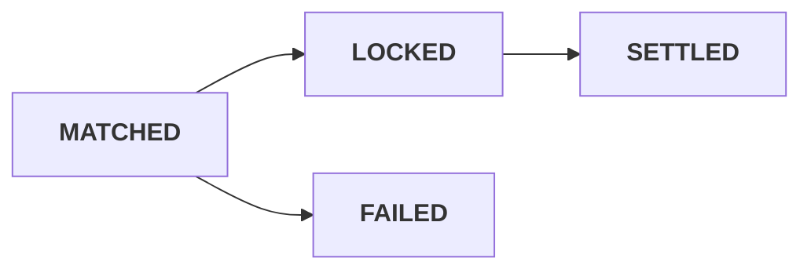

> ## Documentation Index
> Fetch the complete documentation index at: https://docs.sx.bet/llms.txt
> Use this file to discover all available pages before exploring further.

# Bet lifecycle

> How a bet's status changes from placement to settlement on SX Bet.

## The states

| Status | Means |
| - | - |
| `MATCHED` | The matching engine matched you. The on-chain lock is not confirmed yet. |
| `LOCKED` | Funds are escrowed on chain. **The bet is real and irreversible.** |
| `SETTLED` | The fixture is graded and the outcome is recorded in `settlement`. |
| `FAILED` | The on-chain lock did not succeed. No funds moved. |

## Which status to act on

`MATCHED` is the matching engine's word that you are matched. `LOCKED` means the funds are escrowed
on chain, and nothing revises the bet after that.

V3 has driven on-chain lock failures to effectively zero, and a matched bet going on to `LOCKED` is
overwhelmingly the norm. However, expect some hiccups in the early days and we cannot provide 100% guarantees at the moment. So choose by what a
revision would cost you:

* **I can deal with the occasional revised bet** — act on `MATCHED`. It arrives well ahead of the lock (couple seconds), and it is
  what happens in almost every case.
* **I cannot deal with any revised bet** — hedging off-venue, or paying a customer
  against it — wait for `LOCKED`. It is the only irreversible status.

A bet that does not lock ends at `FAILED`, and no funds moved.

## Reading `outcome`

| Value | Means |
| - | - |
| `1` | Outcome one won. |
| `2` | Outcome two won. |
| `0` | **Void.** |

A **quarter-line** bet needs more care. The parent's `outcome` carries direction only, so `outcome`
alone does not tell you whether the bet half-won or fully won. See
[Quarter-line markets](/developers/quarter-line-markets).

## Related

<CardGroup cols={2}>
  <Card title="Order lifecycle" icon="arrow-progress" href="/developers/order-lifecycle">
    The order state machine.
  </Card>

  <Card title="Which grain?" icon="layer-group" href="/developers/which-grain">
    Bet, leg, or position — which endpoint answers your question.
  </Card>
</CardGroup>

This documentation is built and hosted on [Mintlify](https://mintlify.com), a developer documentation platform.