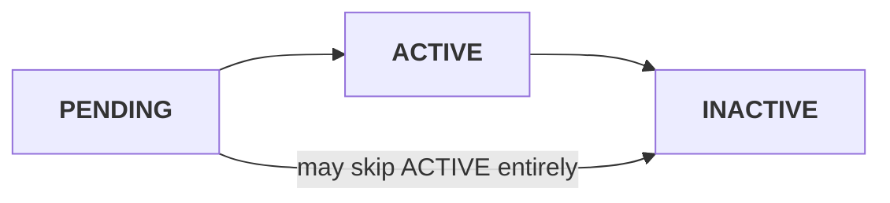

> ## Documentation Index
> Fetch the complete documentation index at: https://docs.sx.bet/llms.txt
> Use this file to discover all available pages before exploring further.

# Order lifecycle

> How order statuses changes during an order's lifetime.

An order has three statuses.

| Status | Means |
| - | - |
| `PENDING` | Accepted and published to the matching engine. **Not live, not yet matchable.** |
| `ACTIVE` | Resting on the book, in whole or in part. |
| `INACTIVE` | No longer resting. `inactiveReason` says why. |

<Warning>
  **`FILLED` is an `inactiveReason`, not a status.** A fully filled order is `status: "INACTIVE"`
  with `inactiveReason: "FILLED"`. A partial fill whose remainder falls below the minimum resting size
  (`limits.minRestingOrderSizeBaseUnits`) is also reported as `FILLED` — the engine discards the dust
  remainder rather than resting it.
</Warning>

IOC or FOK orders ("market orders") **skip `ACTIVE` entirely**. Both go from `PENDING` straight to `INACTIVE`. The order never rests, so it is never `ACTIVE`.

## The `inactiveReason` values

An order becomes `INACTIVE` if it is filled or cancelled. `inactiveReason` tells you which condition applied.

| `inactiveReason` | Fires when |
| - | - |
| `FILLED` | Fully matched, or a partial fill left a remainder below the minimum resting size (`limits.minRestingOrderSizeBaseUnits`), which is discarded. |
| `USER_REQUESTED` | You cancelled it. |
| `EXPIRED` | The order's `expiry` passed. |
| `NO_LIQUIDITY` | An IOC found no compatible liquidity, or an FOK could not fill completely. |
| `INSUFFICIENT_BALANCE` | A balance check failed at match time — on **either** the maker or the taker side. |
| `EVENT_LIFECYCLE` | The fixture moved into a [state that sweeps resting orders](/api-reference/fixture-statuses#which-statuses-sweep-your-resting-orders) — in progress, finished, or cancelled. **Includes kickoff.** |
| `MARKET_HALTED` | An operator explicitly halted the market. |
| `HEARTBEAT_TIMEOUT` | Your [heartbeat](/developers/heartbeat) lapsed. Sweeps **every** open order on your account. |
| `POST_ONLY_WOULD_CROSS` | A [`postOnly`](/developers/time-in-force#post-only) order would have crossed the book on arrival, so it was cancelled instead of matching. |
| `SYSTEM` | The exchange cancelled the order. Covers several distinct internal causes. |

## Related

<CardGroup cols={2}>
  <Card title="Bet lifecycle" icon="receipt" href="/developers/bet-lifecycle">
    What happens after a fill.
  </Card>

  <Card title="Tracking your orders" icon="list-check" href="/developers/my-orders" />

  <Card title="Time in force" icon="clock" href="/developers/time-in-force">
    Order types
  </Card>
</CardGroup>

This documentation is built and hosted on [Mintlify](https://mintlify.com), a developer documentation platform.